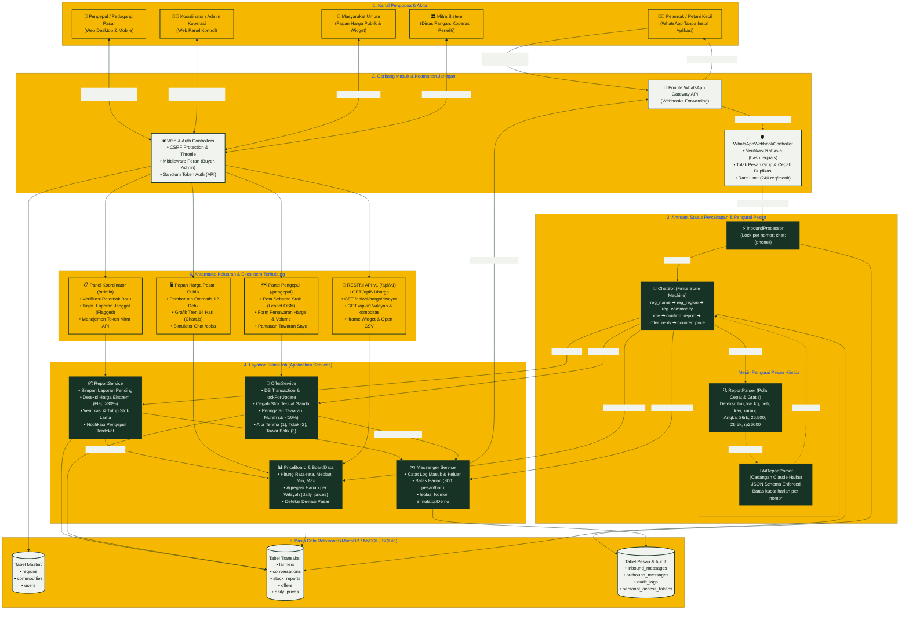

# Arsitektur Sistem — Harlok

Diagram ini memetakan arsitektur perangkat lunak **Harlok** secara menyeluruh, mulai dari kanal komunikasi di tingkat petani (*WhatsApp via Fonnte Gateway*), lapisan keamanan dan pengendali antrean, mesin percakapan berbasis *state machine*, mesin pengurai hibrida (*Regex Rule Parser* + cadangan *Claude AI*), lapisan layanan bisnis, basis data relasional, hingga berbagai kanal diseminasi data (papan publik, antarmuka web peran, dan REST API terbuka).

---

## Diagram Arsitektur (Mermaid)

---

## Deskripsi Rantai Komponen Utama

1. **WhatsApp Ingress (Fonnte Gateway & Webhook):**
   * Endpoint `POST /webhook/wa/{secret}` diamankan menggunakan pemeriksaan waktu konstan `hash_equals` pada parameter URL rahasia.
   * Pesan grup diabaikan secara tegas; duplikasi pesan ditangkal lewat pengecekan keunikan `external_id` Fonnte.
   * Respons HTTP 200 dikembalikan seketika ke Fonnte, sementara badan pesan diproses secara asinkron/terkunci lewat `InboundProcessor` untuk mencegah lonjakan waktu tunggu (*timeout*).

2. **Mesin Pengurai Pesan Hibrida (*Hybrid Report Parsing*):**
   * **Lapisan 1 (ReportParser):** Memanfaatkan ekspresi reguler (*regex*) deterministik yang sangat cepat dan bebas biaya. Mampu mengenali konversi multi-satuan lokal (1 ton = 1.000 kg, 1 kwintal = 100 kg, 1 peti telur = 15 kg, 1 tray telur = 1,9 kg) dan notasi harga informal (`26rb`, `26.500`, `26,5k`, `rp26000`).
   * **Lapisan 2 (AiReportParser):** Menjadi jaring cadangan menggunakan LLM Anthropic Claude Haiku. Format respons dipaksa menggunakan JSON Schema terstruktur dan dibatasi kuota harian per nomor telepon demi menjaga kehematan biaya operasional.
   * **Prinsip Validasi Ketat:** Hasil penguraian apa pun wajib melewati validasi batas harga wajar per komoditas (`min_price` dan `max_price`), serta **wajib dikonfirmasi ulang ke peternak ("YA/UBAH")** sebelum masuk ke basis data.

3. **Layanan Bisnis Inti:**
   * **ReportService:** Mengelola siklus hidup laporan stok (`pending` $\rightarrow$ `confirmed` / `flagged` $\rightarrow$ `closed` / `sold`). Mengotomatiskan penahanan (*flagging*) jika harga yang dilaporkan menyimpang lebih dari 30% dari harga pasar wilayah.
   * **OfferService:** Menjamin keandalan transaksi tawar-menawar menggunakan isolasi transaksi basis data dan penguncian pesimis (`lockForUpdate`), sehingga tidak ada stok yang dapat terjual ganda kepada dua pengepul berbeda.
   * **PriceBoard:** Menghitung statistik harian per wilayah (rata-rata terbobot, median, minimum, maksimum, dan jumlah laporan) hanya dari laporan peternak yang telah terverifikasi oleh koordinator.
   * **Messenger:** Mengatur seluruh transmisi pesan keluar WhatsApp, menegakkan batas harian (maks. 800 pesan/hari), mencatat log pengiriman, dan mencegah pengiriman tak sengaja ke nomor simulator atau nomor uji.

4. **Basis Data & Keamanan Akses:**
   * Memisahkan data master referensi, entitas operasional peternakan, jejak audit aktivitas (`audit_logs`), dan log transmisi pesan.
   * Menjamin privasi nomor telepon dan nama asli peternak; data kontak baru dibuka ke pembeli ketika kesepakatan harga telah disetujui kedua belah pihak.
