# Entity-Relationship Diagram (ERD) — Juru Harga

Diagram ini memodelkan seluruh skema basis data relasional **Juru Harga** secara presisi, mencakup seluruh tabel, tipe data kolom penting, kunci primer (*primary key*), kunci asing (*foreign key*), batasan keunikan (*unique constraint*), serta relasi antarentitas sesuai berkas migrasi `database/migrations/2026_10_28_000001_create_market_tables.php`.

---

## Diagram ERD (Mermaid)

```mermaid
%%{init: {'theme': 'base', 'themeVariables': { 'primaryColor': '#163326', 'primaryTextColor': '#F1F4EE', 'primaryBorderColor': '#F5B700', 'lineColor': '#163326', 'secondaryColor': '#F1F4EE', 'tertiaryColor': '#F5B700'}}}%%
erDiagram
    REGIONS ||--o{ USERS : "memiliki pengguna di"
    REGIONS ||--o{ FARMERS : "domisili lahan/kandang"
    REGIONS ||--o{ STOCK_REPORTS : "lokasi ketersediaan stok"
    REGIONS ||--o{ DAILY_PRICES : "agregasi wilayah"

    COMMODITIES ||--o{ FARMERS : "fokus komoditas utama"
    COMMODITIES ||--o{ STOCK_REPORTS : "jenis komoditas dilaporkan"
    COMMODITIES ||--o{ DAILY_PRICES : "agregasi per komoditas"

    USERS ||--o{ OFFERS : "pengepul mengajukan tawaran"
    USERS ||--o{ PERSONAL_ACCESS_TOKENS : "mitra memiliki token API"

    FARMERS ||--o{ STOCK_REPORTS : "melaporkan stok & harga"
    FARMERS ||--o| CONVERSATIONS : "status percakapan bot (via phone)"
    FARMERS ||--o{ INBOUND_MESSAGES : "rekam pesan masuk (via phone)"
    FARMERS ||--o{ OUTBOUND_MESSAGES : "rekam pesan keluar (via phone)"

    STOCK_REPORTS ||--o{ OFFERS : "menerima penawaran harga"

    REGIONS {
        bigint id PK
        varchar name "Nama kabupaten/kota (60)"
        varchar slug UK "Slug unik untuk URL/API (60)"
        varchar province "Nama provinsi (Bali / DI Yogyakarta)"
        decimal lat "Titik lintang tengah (10,7)"
        decimal lng "Titik bujur tengah (10,7)"
        smallint sort "Urutan tampilan"
    }

    COMMODITIES {
        bigint id PK
        varchar name "Nama komoditas (60)"
        varchar slug UK "Slug unik untuk URL/API (60)"
        json aliases "Sinonim kata lokal (telor, ayam, lombok)"
        json unit_sizes "Definisi konversi satuan lokal (peti, tray)"
        int min_price "Batas bawah harga wajar per kg"
        int max_price "Batas atas harga wajar per kg"
        boolean is_active "Status aktif komoditas"
        smallint sort "Urutan tampilan"
    }

    USERS {
        bigint id PK
        varchar name "Nama lengkap pengguna (255)"
        varchar email UK "Email unik untuk login web"
        varchar password "Hash kata sandi bcrypt"
        varchar role "Peran: admin | buyer | partner"
        varchar phone UK "Nomor WhatsApp pembeli/admin (20)"
        varchar business_name "Nama usaha/koperasi/toko (120)"
        bigint region_id FK "Wilayah operasi (nullable)"
        boolean notify_wa "Notifikasi WhatsApp jika ada stok baru"
        boolean is_active "Status akun aktif"
        boolean is_demo "Penanda akun contoh untuk juri"
        timestamp created_at
        timestamp updated_at
    }

    FARMERS {
        bigint id PK
        varchar name "Nama peternak/petani (80)"
        varchar phone UK "Nomor WhatsApp peternak (20)"
        bigint region_id FK "Relasi ke tabel regions"
        bigint commodity_id FK "Relasi ke tabel commodities"
        decimal lat "Koordinat lintang kandang (10,7)"
        decimal lng "Koordinat bujur kandang (10,7)"
        varchar channel "Kanal: wa | web_sim"
        timestamp verified_at "Waktu verifikasi oleh koordinator"
        boolean digest_opt_in "Langganan ringkasan harga pagi 06.00"
        timestamp last_message_at "Waktu aktivitas pesan terakhir"
        timestamp created_at
        timestamp updated_at
    }

    CONVERSATIONS {
        bigint id PK
        varchar phone UK "Nomor telepon pengirim (20)"
        varchar state "Status: idle | reg_* | confirm_report | offer_reply | counter_price"
        json data "Penyimpanan sementara parameter formulir"
        timestamp expires_at "Waktu batas kedaluwarsa status"
        timestamp created_at
        timestamp updated_at
    }

    INBOUND_MESSAGES {
        bigint id PK
        varchar external_id UK "ID pesan unik dari Fonnte (cegah duplikasi)"
        varchar phone "Nomor WhatsApp pengirim"
        text body "Isi teks pesan masuk mentah"
        varchar channel "Kanal pesan (wa / web_sim)"
        varchar status "Status: received | processed | failed"
        timestamp processed_at "Waktu selesai dieksekusi"
        timestamp created_at
        timestamp updated_at
    }

    OUTBOUND_MESSAGES {
        bigint id PK
        varchar phone "Nomor WhatsApp tujuan"
        text body "Isi teks balasan/notifikasi keluar"
        varchar channel "Kanal pesan (wa / web_sim / log)"
        varchar status "Status: sent | logged | failed"
        varchar error "Keterangan galat jika transmisi gagal"
        timestamp created_at
        timestamp updated_at
    }

    STOCK_REPORTS {
        bigint id PK
        bigint farmer_id FK "Relasi ke tabel farmers"
        bigint commodity_id FK "Relasi ke tabel commodities"
        bigint region_id FK "Relasi ke tabel regions"
        decimal quantity_kg "Jumlah total panen dalam satuan kg (12,2)"
        int price_per_kg "Harga penawaran petani per kg (Rupiah)"
        varchar status "Status: pending | confirmed | flagged | closed | sold | cancelled"
        varchar flag_reason "Alasan penahanan jika deviasi >30%"
        varchar parsed_by "Pengurai: regex | ai | manual"
        varchar raw_text "Teks asli pesan peternak (500)"
        decimal lat "Koordinat sebaran titik stok (10,7)"
        decimal lng "Koordinat sebaran titik stok (10,7)"
        timestamp confirmed_at "Waktu peternak membalas YA"
        timestamp expires_at "Waktu batas aktif stok (default: 3 hari)"
        timestamp closed_at "Waktu stok ditutup/terjual/dibatalkan"
        timestamp created_at
        timestamp updated_at
    }

    OFFERS {
        bigint id PK
        bigint stock_report_id FK "Relasi ke tabel stock_reports"
        bigint buyer_id FK "Relasi ke tabel users (role buyer)"
        int price_per_kg "Harga penawaran pembeli per kg"
        decimal quantity_kg "Jumlah volume kg yang diminta (12,2)"
        int market_avg "Harga rata-rata wilayah saat tawaran dibuat"
        varchar status "Status: sent | countered | accepted | rejected | cancelled"
        int counter_price "Harga tawar balik peternak per kg"
        timestamp responded_at "Waktu tanggapan peternak"
        timestamp created_at
        timestamp updated_at
    }

    DAILY_PRICES {
        bigint id PK
        bigint commodity_id FK "Relasi ke tabel commodities"
        bigint region_id FK "Relasi ke tabel regions"
        date date "Tanggal pembentukan harga harian"
        int avg_price "Harga rata-rata terbobot harian"
        int min_price "Harga terendah terkonfirmasi"
        int max_price "Harga tertinggi terkonfirmasi"
        int median_price "Nilai tengah harga hari bersangkutan"
        int reports_count "Jumlah laporan sampel peternak terverifikasi"
        timestamp created_at
        timestamp updated_at
    }

    AUDIT_LOGS {
        bigint id PK
        varchar actor "Pelaku aksi (user:id / wa:phone / system)"
        varchar action "Jenis aksi (report.confirmed, offer.accepted, dll)"
        varchar subject_type "Model subjek (Polymorphic: StockReport, Farmer, dll)"
        bigint subject_id "ID subjek (Polymorphic ID)"
        json meta "Detail perubahan data & parameter penting"
        varchar ip "Alamat IP pelaku aksi (45)"
        timestamp created_at "Waktu audit tercatat"
    }

    PERSONAL_ACCESS_TOKENS {
        bigint id PK
        varchar tokenable_type "Model pemilik token (App\\Models\\User)"
        bigint tokenable_id "ID pengguna pemilik token"
        varchar name "Nama token (mis. Dinas Pertanian Tabanan)"
        varchar token UK "Hash SHA-256 Bearer Token Sanctum"
        text abilities "Hak izin akses (mis. ['prices:read'])"
        timestamp last_used_at "Waktu pemanggilan API terakhir"
        timestamp expires_at "Waktu kedaluwarsa token (6 bulan)"
        timestamp created_at
        timestamp updated_at
    }
```

---

## Aturan Integritas & Kunci Basis Data

1. **Integritas Multi-Tenancy / Wilayah Terkunci:**
   * Setiap data transaksi harga (`stock_reports` dan `daily_prices`) terikat kuat secara struktural dengan `region_id` dan `commodity_id`.
   * Pengecekan keunikan indeks `['commodity_id', 'region_id', 'date']` pada tabel `daily_prices` menjamin satu komoditas di satu kabupaten hanya memiliki tepat satu baris ringkasan harga harian, sehingga mencegah duplikasi perhitungan rata-rata.

2. **Perlindungan Integritas Transaksi Tawar-Menawar:**
   * `offers.stock_report_id` memiliki relasi `cascadeOnDelete` ke `stock_reports`.
   * Pada saat status tawaran berubah menjadi `accepted`, baris `stock_reports` dikunci menggunakan `lockForUpdate` dalam satu transaksi ACID; status laporan diubah menjadi `sold`, dan seluruh tawaran lain yang berstatus `sent` otomatis digugurkan menjadi `rejected`.

3. **Pemisahan Identitas dan Hak Akses:**
   * Peternak (`farmers`) beroperasi secara independen tanpa akun web. Identifikasi peternak diikat pada nomor telepon unik (`phone`).
   * Pengepul, Koordinator, dan Mitra Data bernaung di bawah tabel `users` dengan pembedaan peran berbasis kolom `role` (`admin`, `buyer`, `partner`).
   * Mitra pengakses API hanya dapat membaca angka agregat pada `daily_prices` dan tidak memiliki hak akses (*permission*) ke data individu di tabel `farmers` atau `offers`.
