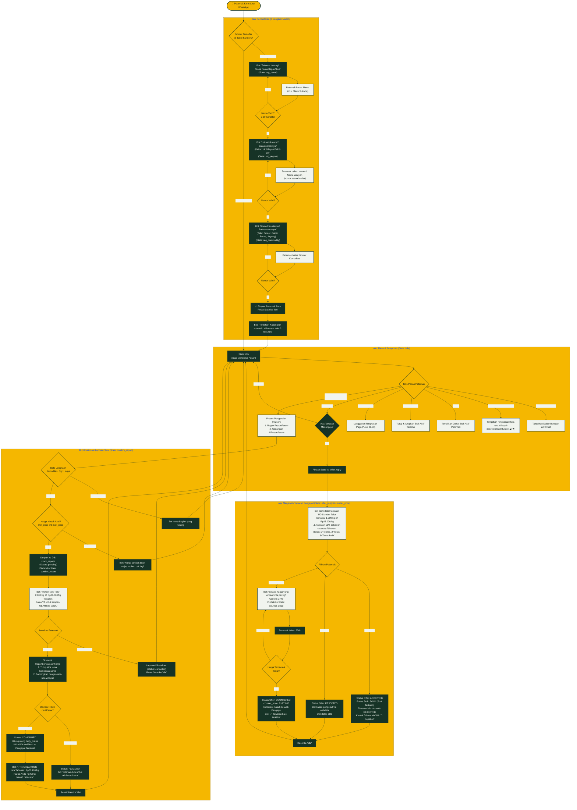
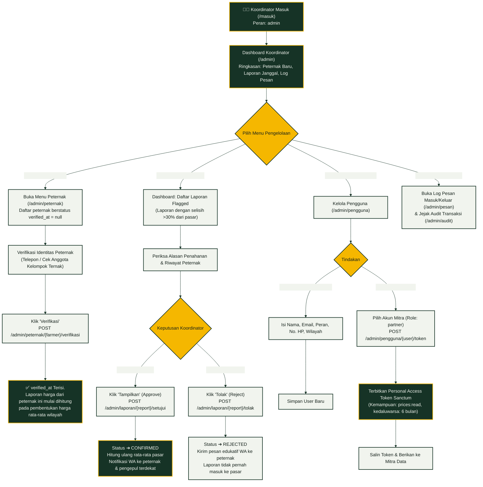
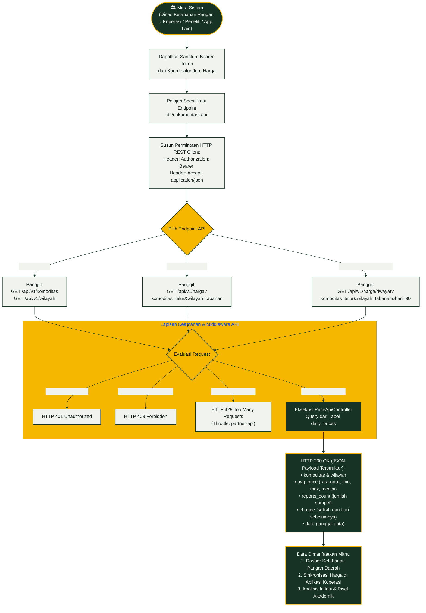

# Alur Pengguna (User Flow) 4 Peran — Juru Harga

Dokumen ini memodelkan diagram alur pengguna (*User Flow*) untuk empat aktor utama sistem **Juru Harga**, yang dibangun secara tepat mengikuti logika kode sumber pada `app/Chat/ChatBot.php`, `app/Services/OfferService.php`, `app/Http/Controllers/BuyerController.php`, `app/Http/Controllers/AdminController.php`, dan `app/Http/Controllers/Api/PriceApiController.php`.

---

## 1. Alur Peternak (WhatsApp Finite State Machine)

Alur percakapan WhatsApp peternak dikontrol oleh mesin status (*finite state machine*) pada tabel `conversations` dengan status: `reg_name` $\rightarrow$ `reg_region` $\rightarrow$ `reg_commodity` $\rightarrow$ `idle` $\rightarrow$ `confirm_report` $\rightarrow$ `offer_reply` $\rightarrow$ `counter_price`.

---

## 2. Alur Pengepul (Pedagang Pembeli di Web)

Pengepul menggunakan antarmuka web responsif (`/pengepul`) untuk mencari pasokan terdekat dan bertransaksi secara transparan:

```mermaid
%%{init: {'theme': 'base', 'themeVariables': { 'primaryColor': '#163326', 'primaryTextColor': '#F1F4EE', 'primaryBorderColor': '#F5B700', 'lineColor': '#163326', 'secondaryColor': '#F1F4EE', 'tertiaryColor': '#F5B700'}}}%%
flowchart TD
    LoginPengepul["🚚 Pengepul Masuk di /masuk<br/>(Akun Didaftarkan Koordinator)"] --> DashboardBuyer["Dashboard Cari Stok (/pengepul)<br/>Peta Interaktif Leaflet + Daftar Stok"]

    DashboardBuyer --> ActionBuyer{"Pilihan Aksi Pengepul"}

    %% Aksi Cari Stok
    ActionBuyer -- "Eksplorasi Stok" --> FilterStok["Filter Komoditas (Telur, Ayam, Cabai)<br/>& Pilih Wilayah"]
    FilterStok --> ViewPin["Periksa Warna Pin di Peta:<br/>🟢 Sekitar Rata-rata<br/>🔴 Di Bawah Pasar<br/>🔵 Di Atas Pasar<br/>⚪ Belum Terverifikasi"]
    ViewPin --> ClickStock["Klik Baris Stok / Pin Peta"]

    ClickStock --> FormTawar["Buka Modal Form Penawaran:<br/>• Isi Harga per kg yang Diajukan<br/>• Isi Jumlah kg yang Diminta<br/>• Sistem tampilkan selisih % dari pasar"]
    FormTawar --> SubmitOffer["Klik 'Kirim Tawaran'<br/>POST /pengepul/stok/{report}/tawar"]

    SubmitOffer --> ValOffer{Validasi Sistem:<br/>1. Stok Masih Tersedia?<br/>2. Qty <= Stok?<br/>3. Bukan Demo menawar WA asli?<br/>4. Belum ada tawaran gantung?}

    ValOffer -- "Gagal" --> ShowErr["Tampilkan Pesan Kesalahan"] --> FormTawar
    ValOffer -- "Lolos" --> CreateOfferDB["✅ Simpan DB offers (Status: sent)<br/>Kunci Transaksi (lockForUpdate)<br/>Messenger kirim WhatsApp ke Peternak"]

    %% Aksi Monitoring
    ActionBuyer -- "Pantau Transaksi" --> ViewOffers["Buka Halaman 'Tawaran Saya'<br/>(/pengepul/tawaran)"]
    CreateOfferDB --> ViewOffers

    ViewOffers --> OfferStatus{"Status Tawaran Peternak"}

    OfferStatus -- "Status: SENT" --> WaitFarmer["Menunggu Tanggapan Peternak via WA<br/>(Pengepul bisa klik 'Batal' bila berubah pikiran)"]
    OfferStatus -- "Status: REJECTED" --> OfferRejected["Ditolak Peternak<br/>(Transaksi Berakhir)"]
    OfferStatus -- "Status: COUNTERED" --> FarmerCountered["Peternak Menawar Balik<br/>(Muncul nominal harga baru & tombol 'Setujui')"]

    FarmerCountered --> AcceptCounter["Klik 'Setujui'<br/>POST /pengepul/tawaran/{offer}/terima"]
    AcceptCounter --> LockDeal["Eksekusi OfferService.accept():<br/>1. Status Offer ➔ ACCEPTED<br/>2. Status Stok ➔ SOLD (Terkunci)<br/>3. Tawaran pembeli lain otomatis ditolak"]

    OfferStatus -- "Status: ACCEPTED" --> DealDone["🤝 KESEPAKATAN TERCAPAI!<br/>• Kontak & Nama Peternak Terbuka di Layar<br/>• Peternak menerima kontak pengepul via WA<br/>• Transaksi fisik & pembayaran dilakukan langsung"]
    LockDeal --> DealDone

    classDef darkGreen fill:#163326,stroke:#F5B700,stroke-width:2px,color:#F1F4EE;
    classDef goldAccent fill:#F5B700,stroke:#163326,stroke-width:2px,color:#14201A;
    classDef paperLight fill:#F1F4EE,stroke:#163326,stroke-width:2px,color:#14201A;

    class LoginPengepul,DashboardBuyer,CreateOfferDB,LockDeal,DealDone darkGreen;
    class ActionBuyer,ValOffer,OfferStatus goldAccent;
    class FilterStok,ViewPin,ClickStock,FormTawar,SubmitOffer,ViewOffers,FarmerCountered,AcceptCounter paperLight;
```

---

## 3. Alur Koordinator (Admin Koperasi & Validasi Data)

Koordinator memastikan keabsahan data sebelum memengaruhi harga pasar agregat wilayah:

---

## 4. Alur Mitra API (Konsumsi Data Terbuka / Interconnected Solutions)

Mewujudkan tema *"Engineering Interconnected Web Solutions"*, sistem membuka integrasi data harga tanpa membocorkan privasi individu:

